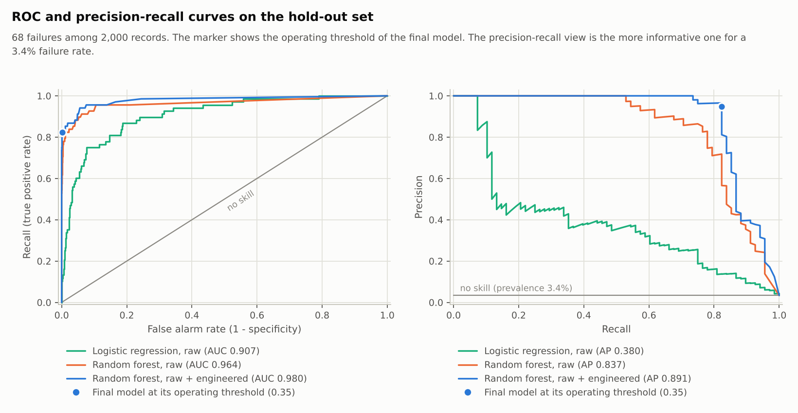
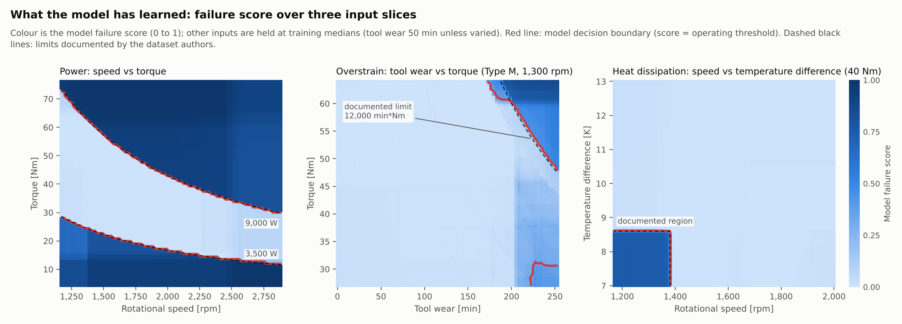
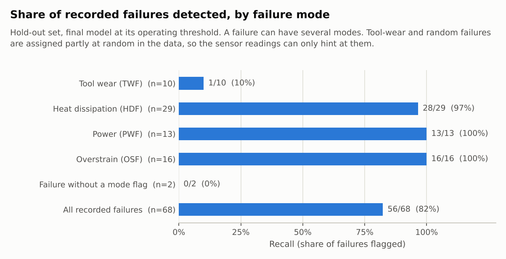
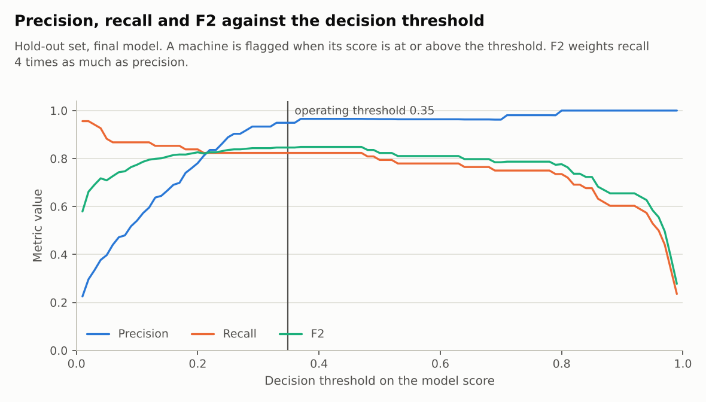

# Machine Failure Prediction and Predictive Maintenance Dashboard

A leakage-free machine-learning pipeline and a Streamlit dashboard that score machine records for
failure risk and turn the score into a transparent inspection recommendation. Built on the public
**AI4I 2020 Predictive Maintenance Dataset** (UCI, 10,000 records of a milling process).

> **Scope.** Offline analysis of a public, **synthetic** benchmark dataset. A result is a screening
> **prediction** that a person has to confirm by inspection, never a confirmed fault. The project has no
> live data connection: it does not do real-time monitoring and has not been deployed on equipment.

## Results (hold-out set, 2,000 records, 68 recorded failures)

The final model is a random forest on the raw sensor readings plus three physically motivated features,
selected by cross-validated PR-AUC on the training set. The hold-out set was used once, after every
choice (model, hyper-parameters, threshold, recommendation rules) had been fixed.

| Model | CV PR-AUC (train) | Precision | Recall | F1 | PR-AUC | ROC-AUC |
|---|---|---|---|---|---|---|
| Majority-class baseline | n/a | 0.000 | 0.000 | 0.000 | 0.034 | 0.500 |
| Logistic regression, raw inputs | 0.442 ± 0.068 | 0.328 | 0.588 | 0.421 | 0.380 | 0.907 |
| Random forest, raw inputs | 0.812 ± 0.035 | 0.740 | 0.794 | 0.766 | 0.837 | 0.964 |
| **Random forest, raw + engineered (final)** | **0.902 ± 0.025** | **0.949** | **0.824** | **0.882** | **0.891** | **0.980** |

- Confusion matrix at the operating threshold 0.349: **56 true alarms, 3 false alarms, 12 missed failures,
  1,929 correct "no failure"** (alert rate 2.95% of machines). MCC 0.880, balanced accuracy 0.911.
- 95% bootstrap intervals (1,000 stratified replicates): recall 0.735–0.912, precision 0.891–1.000,
  PR-AUC 0.822–0.950. With only 68 failures, these intervals are wide.
- Accuracy is not informative: always predicting "no failure" already scores 96.6%.
- By recorded failure mode: power 13/13, overstrain 16/16 and heat dissipation 28/29 detected; tool wear
  only 1/10, as expected, because the dataset generates tool-wear failures partly at random.
- Inspection budget: the top 5% of machines by score contain 86.8% of all hold-out failures; the top 10% contain 94.1%.
- Recommendation levels (model + rules): **High** 60 machines with 57 recorded failures (95.0%),
  **Elevated** 294 with 9 (3.1%), **Low** 1,646 with 2 (0.12%).

All values come from `reports/metrics.json` and `reports/recommendation_levels_holdout.csv`. Re-running the
full pipeline reproduces them exactly (seed 42). The full model card is in [`reports/MODEL_CARD.md`](reports/MODEL_CARD.md).

| | |
|---|---|
|  |  |
|  |  |

These are analysis figures produced by `python -m src.evaluate`, not screenshots of the dashboard
(see [Verification status](#verification-status)).

## How it works

**Data.** `data/raw/ai4i2020.csv` (CC BY 4.0) is validated before use: schema, types, physical ranges
(this catches Celsius entered as kelvin), duplicate ids, binary labels, and the documented failure
criteria, which reproduce the power, heat-dissipation and overstrain labels for 100% of rows. Two
published label quirks are kept as-is and reported: 9 failures without a failure-mode flag and 18
random-failure flags without a failure. See [`data/README.md`](data/README.md) for provenance.

**Leakage control.**
- Model inputs are only `Type` and the five sensor readings. The label, the five failure-mode flags (TWF,
  HDF, PWF, OSF, RNF) and the identifiers are excluded by an explicit guard.
- Engineered features (temperature difference, mechanical power, tool wear × torque) are computed inside
  the scikit-learn `Pipeline`, so training and serving use the same code.
- Scaling, encoding, hyper-parameter search, model selection and the decision threshold are fitted on
  the training split only.
- Tests check that tampering with label columns does not change any score, and that the same pipeline
  falls to chance level when trained on shuffled labels.

**Training** (`python -m src.train`). Stratified 80/20 split → randomised search (24 candidates, 5-fold
stratified CV, PR-AUC) for each candidate model → threshold that maximises F2 on out-of-fold training
scores (recall weighted 4× precision, an explicit cost assumption) → final model chosen by CV PR-AUC →
one hold-out evaluation with bootstrap intervals, per-mode recall, permutation importance and a
reliability check (the score is not a calibrated probability).

**Recommendation layer** (`src/recommend.py`). Two independent, inspectable sources:
1. Model level: **High** at or above the threshold, **Elevated** from half of it, otherwise **Low**.
2. Engineering indicators built on the documented limits of the process: overstrain (tool wear × torque
   above 11,000 / 12,000 / 13,000 min·Nm for Type L / M / H), power outside 3,500–9,000 W, heat
   dissipation (temperature difference below 8.6 K at speed below 1,380 rpm), and the 200–240 min
   tool-wear window. A criterion that is met gives ALERT; approaching it gives WATCH.

The final level is the higher of the two. Each result lists its reasoning, the indicators with their limits,
and what to check (tooling, drive, cooling). The watch margins were chosen by comparing rule
variants on the training split with out-of-fold scores (`reports/recommendation_design.csv`). Wider
margins put about a third of all machines on the watch list for almost no gain.

## Dashboard

`streamlit run app.py` opens four sections:

| Section | Content |
|---|---|
| Overview | Scope, headline numbers computed from the reports, how the system works, data quality and limitations |
| Data exploration | Failure modes and rates, distributions, scatter explorer, documented failure mechanisms, filterable records with CSV download |
| Model evaluation | Model comparison, confusion matrix, ROC/PR curves, an interactive threshold explorer, importance, risk surfaces, per-mode recall, inspection budget, recommendation levels, model-card download |
| Machine assessment | **Single machine**: real hold-out examples or your own readings, validated live, with level, reasoning, indicators, a local sensitivity chart and a JSON download. **Batch**: CSV upload (published or snake_case headers), row-level validation report, prioritised results and CSV download |

Input handling: physical sanity limits with unit hints, warnings for values outside the training range,
upload limits (10 MB, 50,000 rows, 200 columns), in-memory processing only, and spreadsheet-formula
neutralisation in downloaded CSVs. If the saved model is missing or was built with another scikit-learn
version, the app retrains a quick model (default hyper-parameters) on start.

## Quick start

Python 3.11 or newer.

```bash
python -m venv .venv && source .venv/bin/activate      # Windows: .venv\Scripts\activate
pip install -r requirements-dev.txt
pytest                                                 # test suite
streamlit run app.py                                   # dashboard at http://localhost:8501
```

Rebuild every artefact from the CSV (about 3.5 minutes on 2 CPU cores):

```bash
python -m src.data       # validate the dataset, write reports/data_validation.json
python -m src.train      # tune, select, evaluate, save models/ and reports/ (--no-search: fast run)
python -m src.eda        # EDA figures and reports/eda_summary.json
python -m src.evaluate   # evaluation figures, recommendation tables, reports/MODEL_CARD.md
```

`notebooks/walkthrough.ipynb` walks through the same steps using the code in `src/`.

## Project structure

```
app.py                  Streamlit dashboard (layout only; logic lives in src/)
src/
  config.py             paths, schema, documented limits, seeds: every decision in one place
  schema.py physics.py  column names; power / temperature difference / strain and the failure criteria
  validation.py         dataset validation, single-reading and batch (CSV) validation
  data.py               loading, stratified split, leakage-safe feature selection, official download/verify
  features.py           SensorFeatureEngineer (scikit-learn transformer)
  modeling.py           candidate pipelines, CV search, out-of-fold scores, threshold selection
  metrics.py            metrics, bootstrap CIs, per-mode recall, cumulative gains
  train.py evaluate.py  training CLI; figures + model card CLI
  predict.py            model loading, single and batch assessment, local sensitivity
  recommend.py          transparent inspection recommendation rules
  dashboard.py plots.py UI-independent dashboard helpers; matplotlib figures
data/raw/ai4i2020.csv   dataset (CC BY 4.0)
models/                 failure_model.joblib (1.1 MB) and model_card.json
reports/                metrics, predictions, importance, validation, MODEL_CARD.md, figures/
notebooks/              walkthrough notebook
tests/                  pytest suite
screenshots/            placeholder; see the note there
.streamlit/config.toml  theme and server settings
```

## Verification status

Done in the build environment (Linux, Python 3.13.16, scikit-learn 1.9.1, pandas 3.0.5, numpy 2.5.3):
- Full pipeline run from the CSV twice; identical metrics both times.
- `pytest`: **279 passed, 9 skipped**. The 9 skipped tests are the Streamlit `AppTest` tests in
  `tests/test_app.py`. They need Streamlit, which could not be installed there because the Python package
  index was unreachable.
- The dashboard's page code was dry-run against a strict stand-in for the Streamlit API (not part of the
  repository): all four sections, every example, invalid inputs, and malformed and oversized uploads.
  This checks the logic. It does not replace launching the app.

**Not done:** the dashboard has not been launched with a real Streamlit server, and no screenshots exist.
After `pip install -r requirements-dev.txt`, `pytest` also runs the `AppTest` tests. The notebook's
stored outputs come from executing its cells in order with plain Python; it has not been opened in Jupyter.

## Live app

The dashboard is deployed on Streamlit Community Cloud:
**https://machine-failure-prediction-ai4i.streamlit.app**

It runs the committed model and reports as they are. The app was deployed with Python 3.13 and the
latest versions that `requirements.txt` allows. If the installed scikit-learn differs from the one that
trained the model, the app retrains a quick model on start (see *How it works*).

## Limitations

- **Synthetic data.** The labels follow documented rules plus random components, so the model largely
  re-learns those rules. The numbers show how well the pipeline recovers them, not how it would perform on
  real machines, which would need retraining and validation on their own data.
- **Few failures.** 68 hold-out failures give wide confidence intervals.
- **No time dimension.** Records are independent snapshots, with no sensor history, trend or
  remaining-useful-life estimate.
- **Cost assumption.** The threshold assumes a missed failure costs more than an unnecessary inspection
  (F2). Other costs would give a different threshold, and the dashboard's threshold explorer shows the trade-off.
- **Score is not a probability.** A score of 0.35 is not a 35% failure chance (see `eval_calibration.png`).

## Data source and licence

Matzka, S. (2020). *AI4I 2020 Predictive Maintenance Dataset* [Dataset]. UCI Machine Learning Repository.
<https://doi.org/10.24432/C5HS5C>. Licence CC BY 4.0. Code: MIT (see `LICENSE`).
